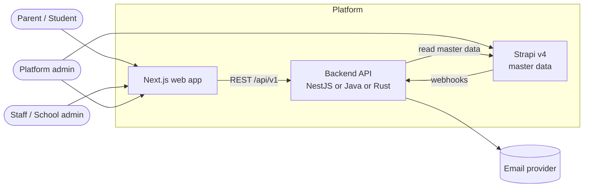
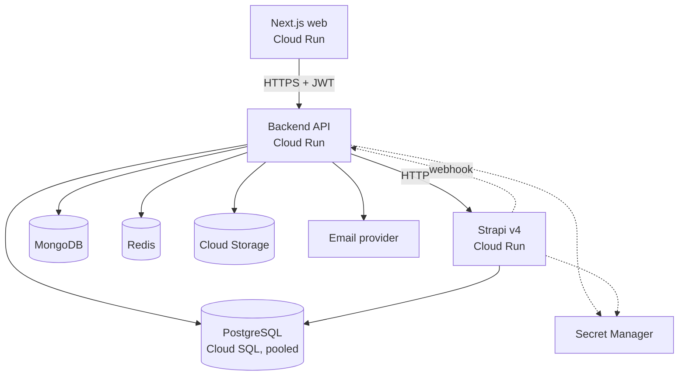
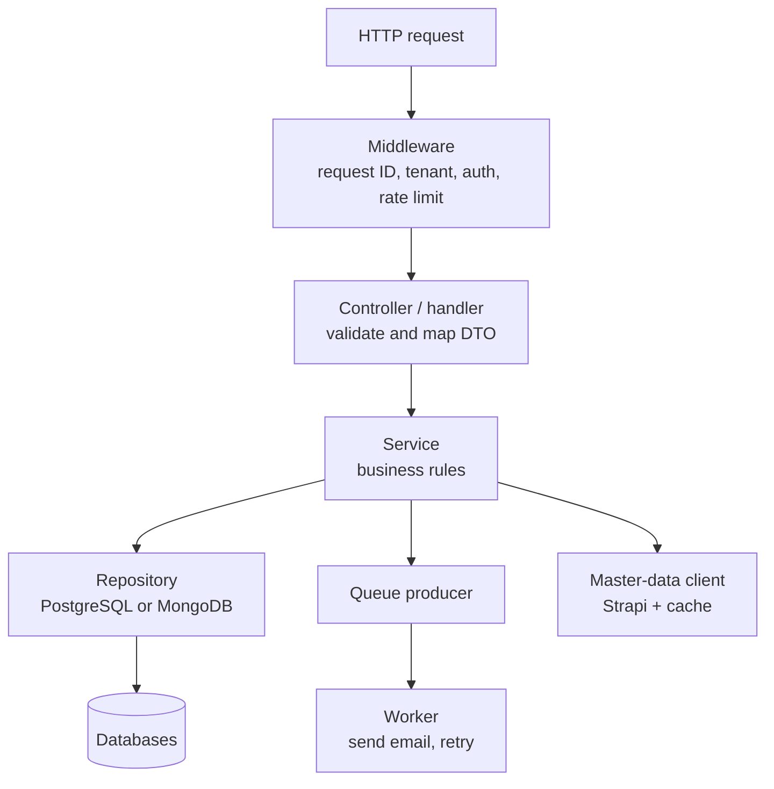
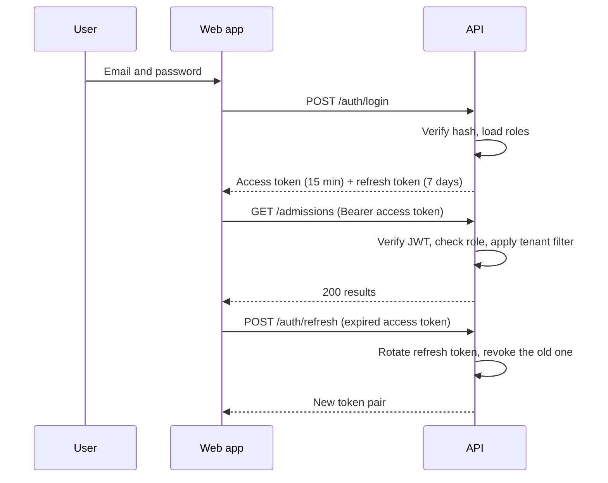
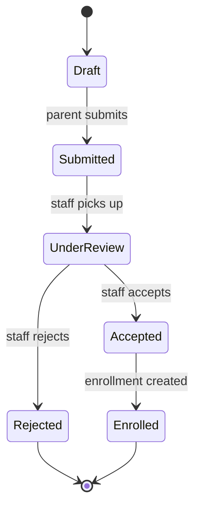
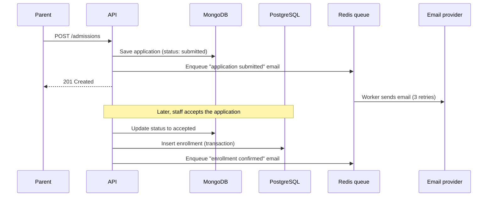
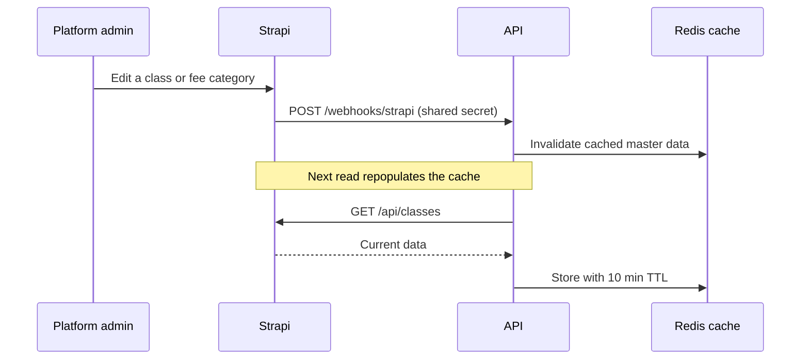
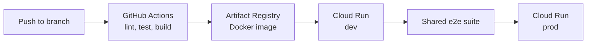

# Architecture: School SaaS Platform

Location in monorepo: `docs/architecture.md`

This document describes how the platform fits together. One Next.js frontend talks to one of three interchangeable backends (NestJS, Spring Boot, Axum). All three implement the same API contract and use the same databases, so the language is the only difference.

## 1. System context

## 2. Container view

| Container | Responsibility | Owner of |
| --- | --- | --- |
| Next.js web | UI, role-based dashboards, calls the API through the generated client | No data |
| Backend API | Business rules, auth, tenancy, validation, notifications | Users, tenants, admissions, enrollments, audit |
| Strapi v4 | Editable master data for non-developers | Classes, academic years, fee categories, referral options |
| PostgreSQL | Relational data and transactions | Tenants, users, roles, enrollments, audit log |
| MongoDB | Flexible documents | Admission applications, notifications, analytics snapshots |
| Redis | Cache, rate-limit counters, job queue | Disposable state only |
| Cloud Storage | Binary files | Uploaded documents |

Each entity has exactly one home store. Strapi uses its own tables in a separate PostgreSQL schema, so it does not touch the API's tables.

## 3. Backend internal layers

The same layering applies in all three languages. Only the names differ.

| Layer | Rule |
| --- | --- |
| Middleware | Sets request ID and tenant ID, verifies the JWT, applies rate limits |
| Controller | Validates input, maps to DTOs, never contains business logic |
| Service | Holds all business rules and the admission state machine |
| Repository | The only code that touches a database; always filters by `tenant_id` |
| Worker | Runs queued jobs outside the request path, retries 3 times |

## 4. Multi-tenancy

- **Model:** shared database, shared schema. Every PostgreSQL row and MongoDB document carries a `tenant_id`.
- **Resolution:** the tenant comes from the subdomain (`school-a.example.com`) or an `X-Tenant-ID` header in local development.
- **Enforcement:** a middleware sets the tenant once per request. Repositories read it from request context, and handlers never pass it by hand.
- **Isolation tests:** the e2e suite includes a test where a user from tenant A requests tenant B's data and must get a 404.
- **Platform admin** is the only role allowed to act across tenants.

## 5. Authentication and authorization

- Passwords are hashed with Argon2.
- Refresh tokens are stored hashed and rotated on every use. Reusing an old one revokes the whole session.
- The token carries the user ID, tenant ID and role. Every endpoint declares which roles may call it.

## 6. Admission and enrollment flow

The status change and the enrollment insert are separate stores, so the service writes the enrollment first and updates the status second. If the second step fails, a retry is safe because the enrollment insert is idempotent on the application ID.

## 7. Master data sync

- Reads go to Redis first, then Strapi.
- The webhook only invalidates the cache. If the webhook is lost, the 10-minute TTL still brings the data up to date.

## 8. Notification pipeline

1. A service enqueues a job in Redis with the template name, recipient and tenant ID.
2. A worker takes the job, renders the HTML template and sends the email.
3. On failure the job is retried 3 times with exponential backoff (1 min, 5 min, 30 min).
4. The final result (sent, failed) is saved in MongoDB, where `GET /notifications` reads it.

## 9. Deployment

| Item | Decision |
| --- | --- |
| Compute | One Cloud Run service per app (web, cms, one per backend) |
| Database | Cloud SQL for PostgreSQL with connection pooling |
| Secrets | Secret Manager, injected as env vars at deploy time |
| Images | One Dockerfile per app, pushed to Artifact Registry |
| Environments | `dev` and `prod`, created from the same Terraform modules |
| CI | One workflow per app, triggered by path filters, plus `deploy.yml` |

Only one backend is routed to the frontend at a time, chosen by an environment variable in the web app. The other two can stay deployed for load testing.

## 10. Observability

- **Logs:** JSON to stdout with `request_id`, `tenant_id`, `user_id` and `route`. Cloud Logging collects them.
- **Metrics:** request rate, error rate and p50/p95/p99 latency per route, plus queue depth.
- **Health:** `/health` (process is alive) and `/ready` (databases and Redis reachable).
- **Errors:** Sentry on the API and the web app.
- **Load tests:** the same k6 scripts in `tests/load/` run against every backend.

## 11. Security summary

- HTTPS only; secrets in Secret Manager; none in the repo.
- Passwords hashed with Argon2; refresh tokens stored hashed and rotated.
- Input validated at the controller layer; output limited to DTOs.
- Rate limiting per tenant and per IP.
- Strapi webhook protected by a shared secret.
- Signed URLs with short expiry for file downloads.
- CORS limited to the web app's origin.

## 12. Key design decisions

Each of these should get its own short file in `docs/adr/` once you commit to it.

| # | Decision | Reason | Trade-off |
| --- | --- | --- | --- |
| 1 | One OpenAPI contract, written first | Makes three backends comparable | Contract changes need a separate pull request |
| 2 | Shared schema in `db/`, not per-ORM migrations | Keeps all backends on the same tables | Each ORM must map onto an existing schema |
| 3 | Shared database and schema for tenants | Simple to run and cheap | Needs strict `tenant_id` discipline and isolation tests |
| 4 | MongoDB for applications, PostgreSQL for enrollments | Applications vary per school; enrollments need transactions | Two stores to keep consistent |
| 5 | Strapi as master-data owner | Non-developers can edit classes and fees | One more service to run |
| 6 | Redis for queue, cache and rate limits | One dependency covers three needs | Redis is a single point of failure for those features |
| 7 | Webhook invalidates cache, TTL is the safety net | Lost webhooks self-heal | Data can be up to 10 minutes stale |
| 8 | Cloud Run over Kubernetes | Less to operate for a portfolio project | Less control over scaling and networking |

## 13. Open questions

- Which email provider will be used (SES, SendGrid, Resend)?
- Will MongoDB run on Atlas or on a self-managed instance in GCP?
- Is a custom domain with wildcard subdomains needed for tenant resolution in the deployed environment?
